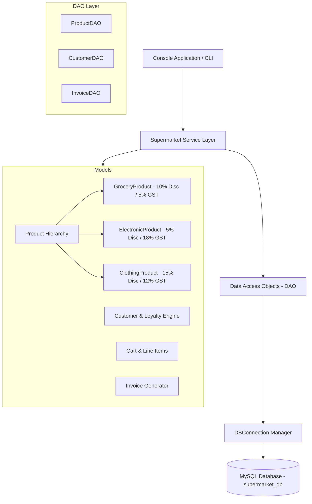
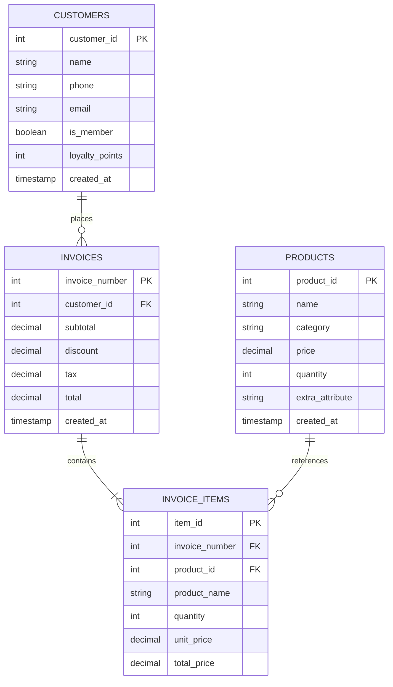

# 🛒 Smart Supermarket Billing System

[](https://github.com/mrtsrihari/supermarket/actions/workflows/ci.yml)
[](https://www.oracle.com/java/)
[](https://www.mysql.com/)
[](https://opensource.org/licenses/MIT)

A modular, production-ready **Supermarket Billing and Inventory Management System** built with **Core Java (OOP)**, **JDBC**, and **MySQL Database**. Designed with clean architectural separation across domain models, data access objects (DAO), business service logic, and an interactive CLI.

---

## 🏛️ System Architecture



---

## 📊 Database Schema (ER Diagram)



---

## ✨ Key Features

1. **Object-Oriented Design (OOP)**:
   - **Polymorphism & Inheritance**: Base abstract `Product` extended by `GroceryProduct` (expiry date), `ElectronicProduct` (warranty in months), and `ClothingProduct` (size).
   - **Interface Segregation**: `Discountable` contract for custom category-based discount calculations.
   - **Encapsulation & Validation**: Custom regex validation for customer phone numbers (`[6-9][0-9]{9}`) and email addresses (`InvalidCustomerException`).

2. **Full MySQL JDBC Integration**:
   - Automated schema creation and self-seeding on initial startup.
   - Externalized database configuration via `db.properties` with environment variable fallback.
   - Data Access Object (DAO) pattern isolating SQL operations (`ProductDAO`, `CustomerDAO`, `InvoiceDAO`).
   - Transactional checkout with ACID guarantees (rolls back if stock update or invoice line item creation fails).

3. **Customer Loyalty & Tiered Discounts**:
   - Automated points calculation (1 point per ₹100 spent).
   - Dynamic tier evaluation:
     - **Platinum**: $\ge 500$ points $\rightarrow$ 10% tier discount
     - **Gold**: $\ge 200$ points $\rightarrow$ 7% tier discount
     - **Silver**: Membership active $\rightarrow$ 5% member discount
     - **Standard**: Non-member

4. **Inventory & Sales Analytics**:
   - Stock deduction and real-time inventory management.
   - Interactive restock and new product additions from the menu.
   - Low-stock threshold alerts (identifies products needing replenishment).
   - Sales reporting: total invoices, total revenue, average bill, top-selling products, and category-wise revenue breakdown.

5. **Quality Assurance & CI/CD**:
   - Built-in test suite (`SupermarketSystemTest`) covering 24 unit & integration test assertions.
   - Automated GitHub Actions workflow testing on JDK 21 on every commit.

---

## 🚀 Getting Started

### Prerequisites
- JDK 8 or later (JDK 21 recommended)
- MySQL Server 8.0 or later (configured on `localhost:3306`)

### Database Configuration
Edit `SupermarketBillingSystem/db.properties` (or set environment variables `DB_USER` and `DB_PASSWORD`):
```properties
db.host=localhost
db.port=3306
db.name=supermarket_db
db.user=root
db.password=Hari123@
```

### Running on Windows
Double-click `SupermarketBillingSystem\run.bat` or run in terminal:
```cmd
cd SupermarketBillingSystem
.\run.bat
```

### Running via Terminal
```bash
cd SupermarketBillingSystem
javac -cp "lib/*" -d out src/supermarket/model/*.java src/supermarket/exception/*.java src/supermarket/db/*.java src/supermarket/dao/*.java src/supermarket/service/*.java src/supermarket/test/*.java src/supermarket/app/*.java
java -cp "out;lib/*" supermarket.app.SupermarketBillingSystem
```

### Running the Test Suite
```bash
java -cp "out;lib/*" supermarket.test.SupermarketSystemTest
```

---

## 📂 Project Structure

```
SupermarketBillingSystem/
├── .classpath                   # Eclipse build path config
├── .project                     # Eclipse project definition
├── db.properties                # Database connection properties
├── run.bat                      # Windows one-click runner script
├── schema.sql                   # MySQL DDL schema and initial seed data
├── lib/
│   └── mysql-connector-j-9.7.0.jar
└── src/
    └── supermarket/
        ├── app/
        │   └── SupermarketBillingSystem.java   # Main CLI entrypoint
        ├── dao/
        │   ├── CustomerDAO.java               # Customer data access
        │   ├── InvoiceDAO.java                # Invoicing and analytics
        │   └── ProductDAO.java                # Product and stock operations
        ├── db/
        │   └── DBConnection.java              # JDBC connection manager
        ├── exception/
        │   └── InvalidCustomerException.java   # Customer validation exception
        ├── model/
        │   ├── Cart.java
        │   ├── CartItem.java
        │   ├── ClothingProduct.java
        │   ├── Customer.java
        │   ├── Discountable.java
        │   ├── ElectronicProduct.java
        │   ├── GroceryProduct.java
        │   ├── Invoice.java
        │   └── Product.java
        ├── service/
        │   └── Supermarket.java               # Business service logic
        └── test/
            └── SupermarketSystemTest.java     # Automated unit & integration tests
```
